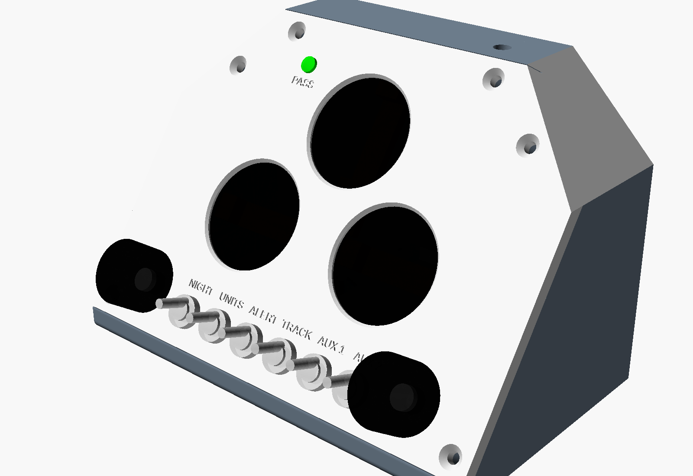
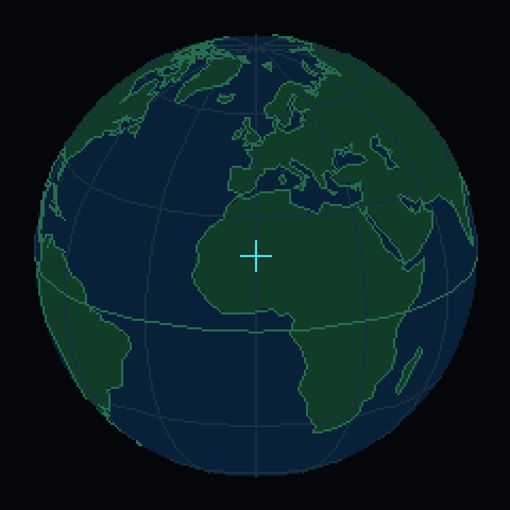
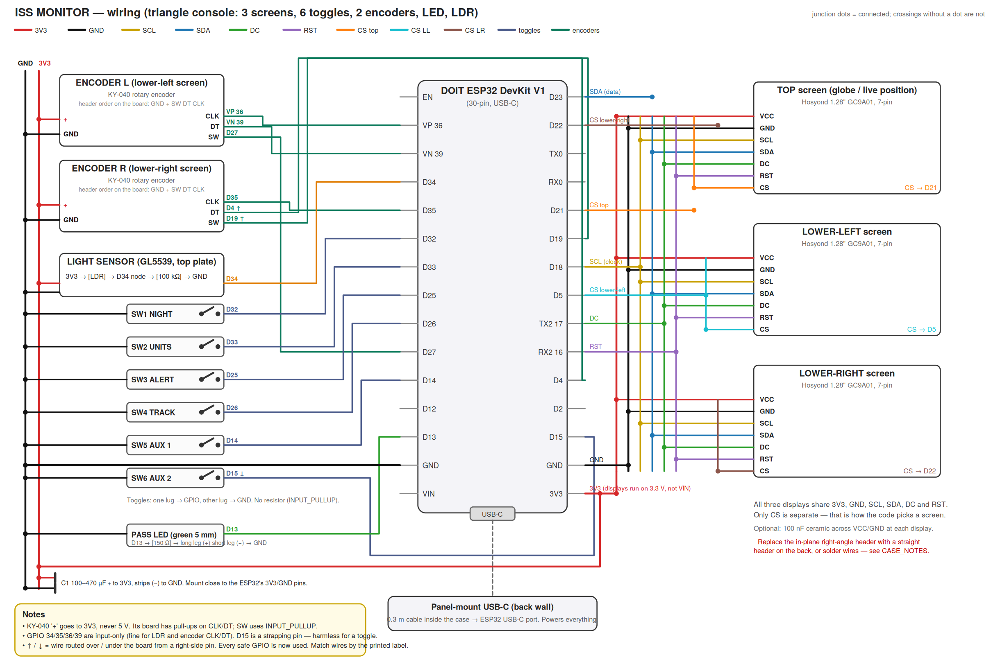

# ISS Monitor

ISS Monitor is a desk console that shows the position of the International Space Station (ISS) in real time. It has three round displays, six toggle switches, two rotary knobs and one LED on a sloped, 3D-printed panel. An ESP32 board gets the orbit data over Wi-Fi. The board calculates the ISS position and the next passes itself.

> **TODO (owner):** Add a photo of the finished console here. The repository has no photo of the built unit.

*Render of the OpenSCAD case model, not a photo.*

## Contents

- [What the console shows](#what-the-console-shows)
- [Controls](#controls)
- [How it works](#how-it-works)
- [Hardware](#hardware)
- [Quick start](#quick-start)
- [Repository layout](#repository-layout)
- [Status and known limits](#status-and-known-limits)
- [Glossary](#glossary)
- [License](#license)

Other documents:

- [docs/build.md](docs/build.md): the parts, the wiring, the perfboard, the printed case and the assembly procedure.
- [docs/firmware.md](docs/firmware.md): the flash procedure, the configuration, the tests, the hardware check sketches and the troubleshooting.
- [PARTS_LIST.md](PARTS_LIST.md): detailed notes on each part and the small circuits.
- [case/CASE_NOTES.md](case/CASE_NOTES.md): detailed notes on the case model and its parameters.
- [firmware/README.md](firmware/README.md): the development log, with bench measurements.

## What the console shows

The three displays sit in a triangle. The globe is at the top. The telemetry screen is at the lower left. The sky screen is at the lower right. Each lower screen has a knob below it that selects its mode.

### Top screen: globe

*Generated preview of the globe drawing. The script `scripts/gen_globe_data.py` makes it with the firmware projection.*

- The screen shows the Earth as an orthographic globe with filled land, coastlines, a graticule and the equator.
- The view follows the point below the ISS. The view moves a small step on each frame, so the globe drifts and does not jump.
- A cross with a circle shows the ISS.
- A small dot in the warning color shows the observer location.
- When the TRACK switch is on, a line shows the recent ground track.
- The text at the bottom shows the latitude and the longitude of the ISS.
- This screen has no knob and one mode.

### Lower-left screen: telemetry

The left knob selects one of four modes.

| Mode | Large value | Small text | Gauge |
|---|---|---|---|
| SPEED | Orbital speed in km/h or mph | ORBITAL VELOCITY | 0 to 32,000 km/h, or 0 to 20,000 mph |
| ALTITUDE | Height above sea level in km or miles | ABOVE SEA LEVEL | 300 to 480 km, or 180 to 300 miles |
| POSITION | Latitude and longitude, two decimals | Ground distance from the observer to the point below the ISS | None |
| STATUS | Link state: BOOT, WIFI.., WIFI OK, TIME OK, TRACKING or OFFLINE | Age of the TLE in hours, and the number of passes in the queue | None |

The firmware calculates the speed from the mean motion in the TLE. It uses a circular orbit, which is accurate to less than one percent for the ISS.

### Lower-right screen: sky

The right knob selects one of four modes.

| Mode | What it shows |
|---|---|
| NEXT PASS | A countdown (HH:MM:SS) to AOS. The text changes to OVERHEAD when the ISS is more than 10° above the horizon. A compass rose shows the path from the AOS azimuth through the highest point to the LOS azimuth. The bottom line shows the maximum elevation, the rise and set directions, and VISIBLE or NOT LIT. |
| SKY NOW | A polar plot of the sky. The zenith is at the center, the horizon is at the edge and north is at the top. A dot shows the ISS when it is above the horizon. The text shows the azimuth and the elevation. |
| SCHEDULE | The next three passes: the time to AOS, the maximum elevation, the rise direction, and VIS for a visible pass. |
| VISIBILITY | VISIBLE, NOT LIT or NO DATA for the next pass. |

A pass is visible when the ISS is in sunlight and the sun is 6° or more below the observer's horizon. The firmware does this check at the highest point of the pass.

### PASS LED

The green LED above the top screen shows pass alerts. It operates only when the ALERT switch is on.

| Condition | LED |
|---|---|
| ALERT switch is off | Off |
| The ISS is more than 10° above the horizon | On, full brightness |
| The next AOS is 300 seconds away or less | Pulses. The pulse period decreases from 2.5 s to 0.5 s as AOS comes nearer. |
| All other conditions | Off |

## Controls

| Control | Function |
|---|---|
| Left knob, turn | Selects the next or the previous telemetry mode. |
| Left knob, push | Selects the next telemetry mode. |
| Right knob, turn | Selects the next or the previous sky mode. |
| Right knob, push | Selects the next sky mode. |
| NIGHT switch | Changes all screens from the amber day palette to a dark red palette. The red palette keeps your eyes adapted to the dark. |
| UNITS switch | On: miles and mph. Off: km and km/h. |
| ALERT switch | On: arms the PASS LED. |
| TRACK switch | On: shows the ground track on the globe. |
| AUX 1 switch | No function yet. See [Status and known limits](#status-and-known-limits). |
| AUX 2 switch | No function yet. |
| Light sensor | In a dark room, the console changes to the red palette automatically. |

The displays have no backlight control. The night mode uses dark colors to make the screens dimmer.

## How it works

The firmware runs one cooperative loop on the ESP32. No task blocks the loop after `setup()`, with one exception: the HTTPS request for the TLE stops the loop for approximately one second.

1. **Start-up.** The firmware deselects all three displays and resets them with one pulse on the shared reset line. Then it starts each display and shows a splash screen.
2. **Cached orbit data.** The firmware reads the last TLE from NVS flash. Thus the console can calculate the ISS position before the network is available.
3. **Wi-Fi and time.** A state machine connects to Wi-Fi and gets the time from NTP (`pool.ntp.org`, `time.nist.gov`). After a failure, it waits 2 s, then 4 s, then longer, to a maximum of 120 s.
4. **TLE download.** The firmware gets the ISS TLE from Celestrak over HTTPS at start-up and every 6 hours. It does a check of the checksum on each line. It keeps the old TLE if the new one is bad, and it saves a good TLE to NVS.
5. **Propagation.** Each second, the SGP4 library calculates the ISS position from the TLE and the time. The firmware then calculates the look angles from the observer, the ground distance and the speed.
6. **Pass prediction.** The firmware searches the next 36 hours in 60-second steps for the times when the ISS goes above 10° elevation. It finds each crossing to the second by bisection, and the highest point by a ternary search. It keeps a maximum of four passes. It does the search again after each TLE load and after the end of the current pass.
7. **Display.** Every 100 ms, each screen draws the data that changed. The lower screens draw into an off-screen buffer that the firmware turns by 135° before it sends it to the display. The modules sit at that angle in the panel because of their header tabs.
8. **Inputs.** The firmware reads the switches every 5 ms with a 25 ms debounce. An interrupt routine counts the knob steps. The light sensor gives a smoothed value every 100 ms.

All screens read one shared data structure, `AppState` in `firmware/src/app/state.h`. Only the application layer writes to it. The orbit math in `firmware/lib/orbit/` has no Arduino dependency. Thus the unit tests run on a computer without the hardware.

[docs/firmware.md](docs/firmware.md#architecture) gives more detail.

## Hardware

The console uses these main parts:

- One DOIT ESP32 DevKit V1 board (original ESP32, USB-C).
- Three 1.28 inch GC9A01 round TFT displays, 240 × 240 pixels, on one SPI bus.
- Six MTS-101 mini toggle switches (two-pin, on/off).
- Two KY-040 rotary encoder modules with push buttons, and two knobs.
- One GL5539 photoresistor and one 100 kΩ resistor for the light sensor.
- One 5 mm green LED and one 150 Ω resistor.
- One 100–470 µF electrolytic capacitor across 3V3 and GND.
- One 4 × 6 cm perfboard.
- One panel-mount USB-C extension cable, 0.3 m.
- A printed case: a front panel, a rear shell, three clamp bars and optional bezel rings.

[docs/build.md](docs/build.md) has the full bill of materials, the pin map, the wiring and the assembly procedure.

*The wiring diagram shows the first pin plan. The mode switches and the knobs use different pins in the finished unit. Use the pin map in [docs/build.md](docs/build.md#pin-map).*

## Quick start

This procedure is for a console that you have already wired. [docs/firmware.md](docs/firmware.md) gives the full procedure.

1. Install PlatformIO Core or the PlatformIO IDE extension for VS Code.
2. Clone this repository.
3. Run `./scripts/vendor_libs.sh` from the repository root. This script gets LovyanGFX and Sgp4.
4. Copy `firmware/src/secrets_example.h` to `firmware/src/secrets.h`.
5. Write your Wi-Fi name and password in `firmware/src/secrets.h`.
6. Write your latitude, longitude, height and time zone in `firmware/include/config.h`.
7. Connect the ESP32 to the computer with a USB data cable.
8. Run `pio run -t upload -t monitor` in the `firmware` folder.

## Repository layout

| Path | Contents |
|---|---|
| `firmware/` | The PlatformIO project: source, configuration, tests and hardware check sketches. |
| `firmware/lib/orbit/` | TLE parser, coordinate math and pass prediction. No Arduino code. |
| `firmware/test/` | Unity unit tests for `lib/orbit` and the land mask. |
| `firmware/hw_check/` | Small sketches that each do a check of one part of the hardware. |
| `case/` | The OpenSCAD model, the STL files, the renders and the panel drawing. |
| `scripts/` | `vendor_libs.sh` gets the libraries. `gen_globe_data.py` makes the globe tables. |
| `PARTS_LIST.md` | Detailed parts notes and small circuits. |
| `WIRING_DIAGRAM.svg`, `.png` | Wiring diagram (first pin plan). `wiring_diagram.py` makes the SVG. |
| `PERFBOARD_LAYOUT.svg`, `.png` | Perfboard layout for the ESP32 and the connectors. |

## Status and known limits

- **AUX 1 and AUX 2 have no function.** The firmware reads them but does not use them. `config.h` has constants for a Morse code beacon on AUX 1, but no code uses them yet.
- **The ground track is short.** The track keeps the last 90 positions, one each second. A comment in `state.h` expects one point each 30 seconds. **TODO (owner):** confirm the intended track length.
- **The observer location is fixed at compile time.** Change it in `config.h`.
- **The TLE download does not verify the server certificate.** The worst result of a false TLE is a wrong position on the screens.
- **The case revision in the repository has no recorded test print.** The last change moved the USB-C mount. See [docs/build.md](docs/build.md#print-the-case).

## Glossary

| Term | Meaning |
|---|---|
| ADC | Analog-to-digital converter. The ESP32 reads the light sensor voltage with it. |
| AOS | Acquisition of signal. In this project, the time when the ISS goes above 10° elevation. |
| Azimuth | The compass direction to an object, in degrees clockwise from north. |
| Celestrak | A public website that supplies orbit data for satellites. |
| CS | Chip select. Each display has one CS line. A low level on it selects that display on the shared bus. |
| Elevation | The angle of an object above the horizon, in degrees. |
| Ground track | The line on the Earth below the path of the ISS. |
| GPIO | General-purpose input/output pin on the ESP32. |
| Heat-set insert | A threaded brass insert that you push into a plastic hole with a hot soldering iron. |
| LDR | Light-dependent resistor (photoresistor). |
| LOS | Loss of signal. In this project, the time when the ISS goes below 10° elevation. |
| NTP | Network Time Protocol. It supplies the correct time over the network. |
| NVS | Non-volatile storage. An area of the ESP32 flash that keeps data after power is removed. |
| Pass | One period when the ISS is above 10° elevation for the observer. |
| Perfboard | A circuit board with a grid of holes for hand-soldered circuits. |
| PlatformIO | A build system for embedded firmware. |
| SGP4 | Simplified General Perturbations 4. The standard model that calculates a satellite position from a TLE. |
| SPI | Serial Peripheral Interface. The bus that sends the image data to the displays. |
| Strapping pin | An ESP32 pin that the chip reads at start-up to select a boot mode. |
| Subpoint | The point on the Earth directly below the ISS. |
| TLE | Two-line element set. A standard text format for the orbit of a satellite. |
| Unity | A small unit test framework for C. |

## License

MIT. See [LICENSE](LICENSE). The coastline and land data come from Natural Earth, which is in the public domain. The files in `firmware/test/unity_vendor/` are from the Unity project and have their own MIT license header.
