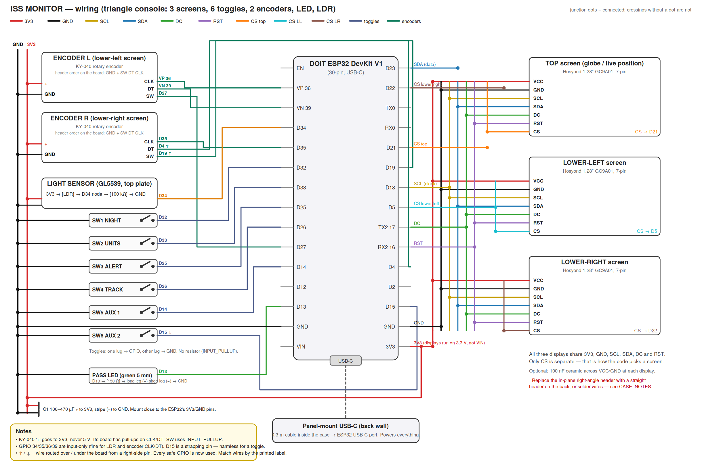
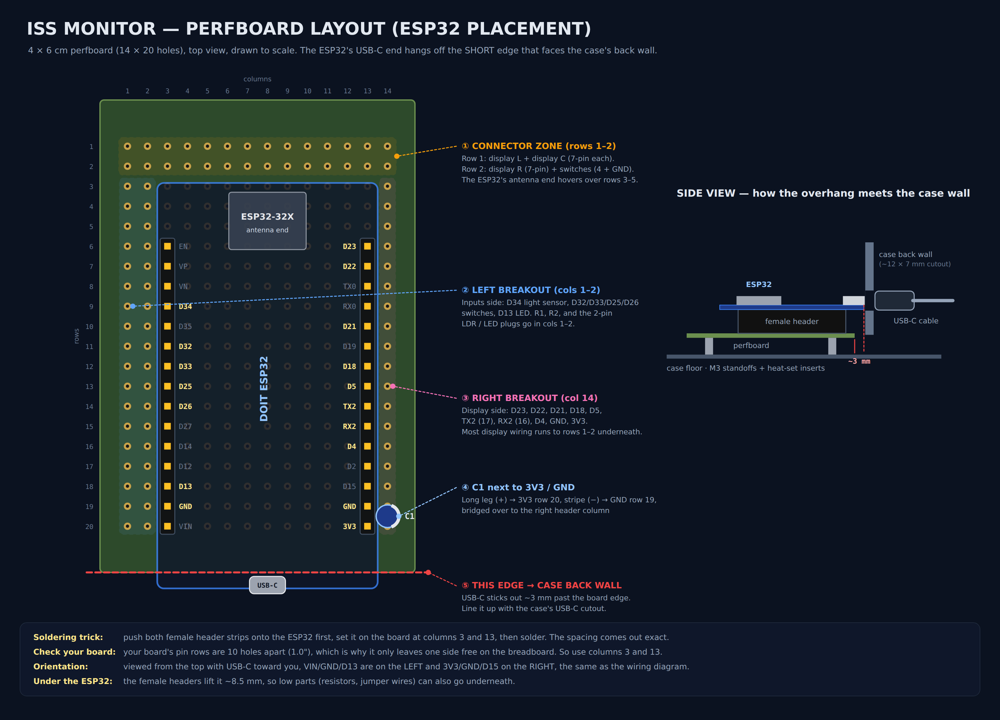
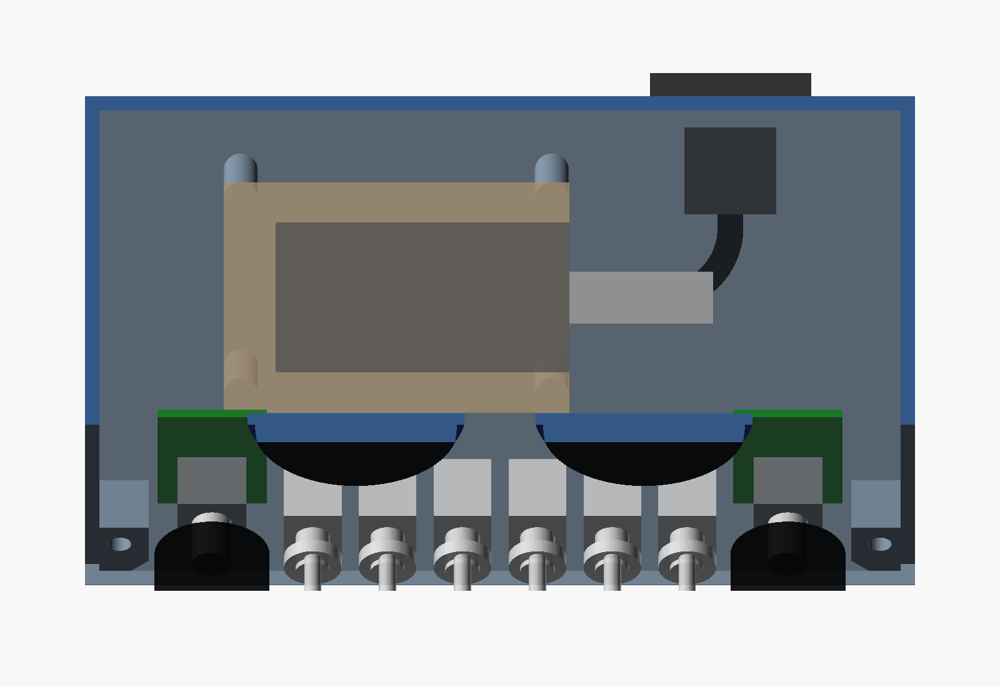

# Build guide

This guide tells you how to build the ISS Monitor hardware. It covers the parts, the pin map, the circuits, the perfboard, the printed case and the assembly. For the firmware, see [firmware.md](firmware.md). The [glossary](../README.md#glossary) in the README defines the technical terms.

## Contents

- [Bill of materials](#bill-of-materials)
- [Tools](#tools)
- [Pin map](#pin-map)
- [Circuits](#circuits)
- [Perfboard](#perfboard)
- [Print the case](#print-the-case)
- [Assembly procedure](#assembly-procedure)
- [Open items](#open-items)

## Bill of materials

[PARTS_LIST.md](../PARTS_LIST.md) and [case/CASE_NOTES.md](../case/CASE_NOTES.md) give more detail on each part. This table combines the two lists.

> **TODO (owner):** Add supplier links and an approximate cost for each part.

### Electronics

| Qty | Part | Notes |
|---|---|---|
| 1 | DOIT ESP32 DevKit V1 board, USB-C | Original ESP32 with Wi-Fi, no PSRAM. The unit uses a board with FCC ID 2BB77-ESP32-32X. |
| 3 | 1.28 inch GC9A01 round TFT display, 240 × 240, SPI | The unit uses Hosyond modules. Use the 7-pin type (no BLK pin). See the caution in [Pin map](#pin-map). |
| 6 | MTS-101 mini toggle switch, 2-pin on/off, 6 mm bushing | The unit uses Taiss switches. Four mode switches and two AUX switches. |
| 2 | KY-040 rotary encoder module, 20 detents, push button, M7 bushing | One below each lower screen. |
| 2 | Knob, 20 × 15.5 mm, 6 mm D-shaft, set screw | The unit uses Taiss knobs. |
| 1 | GL5539 photoresistor | Light sensor (LDR). |
| 1 | 100 kΩ resistor | R1, the light sensor divider. Color bands: brown-black-yellow. |
| 1 | 5 mm green LED, 2.8–3.6 V, 20 mA | PASS LED. |
| 1–2 | 150 Ω resistor | R2, the LED resistor. Two in parallel give 75 Ω if the LED is too dim. |
| 1 | Electrolytic capacitor, 100–470 µF, 10 V or more | C1, across 3V3 and GND. It prevents brownout resets when Wi-Fi starts. |
| 0–4 | Ceramic capacitor, 100 nF ("104") | Optional. One across VCC and GND at each display, and one at the ESP32 3V3 pin. |
| 1 | Perfboard, 4 × 6 cm | Main board. |
| 2 | Female header strip, 2.54 mm | Socket for the ESP32. |
| ~40 pins | Male header strip, 2.54 mm | Connectors for the displays, the switches, the LDR and the LED. |
| ~30 | Female-to-female jumper wire, 20 cm | From the perfboard to the panel parts. |
| 1 | Panel-mount USB-C extension cable, 0.3 m, male to female | It must carry data. Then you can program the ESP32 through it. The unit uses a type with a screw flange. |
| 1 | USB-C data cable and a 5 V USB power supply | The console uses less than 500 mA (estimate, not measured). |

### Case hardware

| Qty | Part | Where it goes |
|---|---|---|
| 11 | M3 heat-set insert, approximately 4.5 mm outer diameter | Six in the panel posts of the shell, five in the clamp bosses of the panel. |
| 6 | M3 × 8 flat-head (countersunk) screw | Panel to shell. |
| 6 | M3 × 8 screw, any head | Clamp bars to bosses. |
| 4 | M3 × 6 self-tapping screw | Perfboard to the floor pegs. |
| — | Hot glue | Holds the USB-C connector in the back-wall cutout. |
| 4 | 10 mm stick-on rubber foot | Recesses in the bottom of the shell. |

### Filament

PLA or PETG. **TODO (owner):** record the filament and the color that the finished unit uses.

## Tools

- Soldering iron, solder and flux remover.
- Multimeter.
- Flush cutters and wire strippers.
- A 3D printer. The largest part is 144 × 107.6 mm on the bed. The first unit used a Bambu Lab P1S.
- A computer with PlatformIO. See [firmware.md](firmware.md).
- Optional: OpenSCAD, if you change the case model.

## Pin map

This table comes from `firmware/include/config.h`. That file is the only source of the pin numbers in the firmware. If you change a wire, change `config.h` to match.

> **Note:** `WIRING_DIAGRAM.png` shows the first pin plan. In the finished unit, the UNITS, ALERT and TRACK switches use different pins, and the two knobs use each other's pins. Use this table.



### Displays

All three displays share every line except CS. Connect each wire by the label on the ESP32 board, not by the pin position.

| Display pin | ESP32 pin |
|---|---|
| VCC | 3V3 |
| GND | GND |
| SCL (SPI clock) | D18 |
| SDA (SPI data) | D23 |
| DC | TX2 (GPIO 17) |
| RST | RX2 (GPIO 16) |

| Screen | CS pin | Rotation in the panel |
|---|---|---|
| Lower left: telemetry | D5 | −135° |
| Top: globe | D21 | 90° |
| Lower right: sky | D22 | 135° |

The "SDA" and "SCL" labels on these modules are SPI signals, not I2C.

> **CAUTION:** Do not use a display module with an eighth BLK (backlight) pin without a pin change. The pin map uses D4 for the left knob. A BLK pin on D4 causes a conflict.

### Switches, knobs, LED and light sensor

All switches connect one leg to the ESP32 pin and the other leg to GND. The firmware turns on the internal pull-up resistors. A switch that is on reads LOW.

| Part | Panel position | ESP32 pin |
|---|---|---|
| NIGHT switch | Slot 1 (left) | D32 |
| UNITS switch | Slot 2 | D26 |
| ALERT switch | Slot 3 | D33 |
| TRACK switch | Slot 4 | D25 |
| AUX 1 switch | Slot 5 | D14 |
| AUX 2 switch | Slot 6 (right) | D15 |
| Left knob CLK / DT / SW | Below the lower-left screen | D35 / D4 / D19 |
| Right knob CLK / DT / SW | Below the lower-right screen | VP (GPIO 36) / VN (GPIO 39) / D27 |
| KY-040 `+` and GND | Both knobs | 3V3 and GND |
| Light sensor | Shell top plate | D34 |
| PASS LED | Above the top screen | D13 |

GPIO 34, 35, 36 and 39 are input-only and have no internal pull-up. The KY-040 module has its own 10 kΩ pull-ups on CLK and DT, so these pins are correct for the knobs. D15 is a strapping pin. A toggle switch on D15 only changes the boot log output.

> **CAUTION:** Connect the KY-040 `+` pin to 3V3, not to 5 V. The ESP32 inputs accept a maximum of 3.3 V.

### Pins that you must not use

| Pins | Reason |
|---|---|
| GPIO 6–11 | Connected to the flash chip on the board. |
| GPIO 0, 2, 12 | Strapping pins. A load on them can stop the board from starting or from accepting firmware. |
| GPIO 1, 3 (TX0, RX0) | USB serial for upload and the serial monitor. |

## Circuits

### Light sensor

```
3V3 ──[ GL5539 LDR ]──┬── D34
                      │
                  [ 100 kΩ ]
                      │
                     GND
```

More light gives a lower LDR resistance and a higher reading on D34 (0–4095). D34 is on ADC1, which operates while Wi-Fi is on. The firmware changes to the night palette below a reading of 800. It changes back above 950.

### PASS LED

```
D13 ──[ 150 Ω ]──►|── GND
              green LED, long leg toward the resistor
```

A 330 Ω resistor makes this LED too dim on a 3.3 V pin. The 150 Ω resistor gives approximately 2–4 mA.

> **CAUTION:** Do not use a resistor of less than 47 Ω. A lower value can damage the GPIO pin.

### Bulk capacitor

Connect C1 between 3V3 and GND, near the ESP32 pins. Connect the leg with the stripe (−) to GND.

> **WARNING:** Do not connect an electrolytic capacitor in reverse. A reversed capacitor can get hot and burst.

## Perfboard



The ESP32 plugs into two female header strips in columns 3 and 13. The connectors for the panel parts are in rows 1–2, columns 1–2 and column 14. The antenna end of the ESP32 is above rows 3–5, so do not put connectors there.

> **Note:** The perfboard drawing shows the USB-C port toward the back wall. The current case model turns the board so that the USB-C port faces the right side wall. The column and row plan stays the same. See the floor layout below.



## Print the case

The case model is `case/ISS_console.scad`. It is parametric. The ready-made STL files are in `case/stl/`. The assembled case is 144 mm wide, 85 mm deep and 96.5 mm high. The front panel tilts 35° back from vertical.

| File | Part | Size (mm) | Orientation on the bed | Supports |
|---|---|---|---|---|
| `ISS_console_panel.stl` | Front panel: three screen openings, six switch holes, two knob holes, the LED hole, engraved labels and five clamp bosses | 144 × 107.6 × 11 | Face down (already turned) | None |
| `ISS_console_shell.stl` | Rear shell: floor, sides, back, top, six screw posts, USB-C pad, perfboard pegs and LDR hole | 144 × 96.5 × 85 | Back wall on the bed (already turned) | None |
| `ISS_console_clamp.stl` | Three clamp bars that hold the displays against the panel | 58 × 32 × 8.1 | Flat, feet up | None |
| `ISS_console_bezel.stl` | Three optional bezel rings for the screen openings | 134 × 42 × 1.5 | Flat | None |

Use these print settings:

- Material: PLA or PETG.
- Layer height: 0.2 mm.
- Walls: 3.
- Infill: 20%.

The shell has a 15 × 8.5 mm cutout for the USB-C connector, 40 mm right of the center line. The model also has two 2.5 mm holes, 22.4 mm apart, for M3 screws through the connector flange. The finished unit does not use these holes. Its connector is fixed with hot glue. The screw mount is an option.

Print the panel first. Do a test fit of each panel part before you print the shell. The labels are 0.6 mm deep. You can fill them with a paint marker. A textured build plate gives a good front surface on the panel.

> **Note:** The shell STL includes the last change to the USB-C mount position. No test print of this revision is recorded. **TODO (owner):** confirm a test print of the current shell.

### Change the model

1. Install OpenSCAD.
2. Open `case/ISS_console.scad`.
3. Measure the parameters that have the `MEASURE` comment. [case/CASE_NOTES.md](../case/CASE_NOTES.md#measurements-to-confirm-single-line-edits-at-the-top-of-the-scad-marked-measure) lists them.
4. Set `part` to `panel_print`, `shell_print`, `clamp_print` or `bezel_print`.
5. Render the part with F6.
6. Export the part as STL.

`case/panel_layout_1to1.pdf` is a dimensioned drawing of the front panel. It prints at 1:1 on Letter paper. Measure the 100 mm bar on the printout to make sure that the scale is correct.

## Assembly procedure

Do the hardware checks in [firmware.md](firmware.md#hardware-check-sketches) during this procedure. Each check finds one type of fault before the next step hides it.

### Prepare the displays

The displays come with a right-angle header in the plane of the board. That header does not fit in the panel.

1. Remove the right-angle header from each display.
2. Install a straight header that points to the rear, or solder wires directly to the pads.

### Test the parts on a breadboard

1. Connect the LED circuit to D13.
2. Flash the `led` sketch. See [firmware.md](firmware.md#hardware-check-sketches).
3. Make sure that the LED blinks and fades.
4. Connect the three displays to the shared bus, each with its own CS pin.
5. Flash the `smoketest` sketch.
6. Make sure that each display shows its own color and name: red TELEMETRY, green GLOBE, blue SKY.
7. Connect the switches, the knobs and the light sensor.
8. Flash the `inputs` sketch.
9. Make sure that each switch and each knob gives one line on the serial monitor for each change.

The ESP32 board is too wide for one breadboard. Put two breadboards side by side and remove the power rail between them.

### Build the perfboard

1. Put both female header strips on the ESP32 pins.
2. Put the ESP32 and the headers on the perfboard at columns 3 and 13.
3. Solder the headers.
4. Remove the ESP32.
5. Solder the male header connectors in rows 1–2, columns 1–2 and column 14.
6. Solder R1, R2 and C1.
7. Solder the connections from the ESP32 headers to the connectors.
8. Remove the flux residue between the pins.

> **CAUTION:** Clean the flux between D32 and the adjacent pins carefully. On the first unit, a partial short there made the NIGHT state change when the left knob turned. The `leak` sketch finds this fault.

### Do the checks before you apply power

Do these checks each time you change the wiring.

1. Make sure that all grounds connect together.
2. Make sure that nothing connects to GPIO 0, 2, 12 or 6–11.
3. Make sure that the displays connect to 3V3, not to VIN (5 V).
4. Make sure that the stripe on C1 connects to GND.
5. Make sure that the long leg of the LED is toward the resistor.
6. Measure the resistance between 3V3 and GND with a multimeter. Make sure that there is no short circuit.

### Install the parts in the panel

> **WARNING:** Do not touch the soldering iron tip or a hot brass insert. They cause burns.

1. Install the five M3 heat-set inserts in the clamp bosses on the rear of the panel.
2. Put each display in its pocket with the glass toward the front.
3. Turn each display so that its header tab points into the relief pocket. The top tab points right. The lower-left tab points up and left. The lower-right tab points up and right.
4. Attach the three clamp bars with six M3 × 8 screws. The two lower bars are horizontal and share the middle boss. The top bar is vertical.
5. Install the six toggle switches in slots 1–6 with their nuts. Put them in the order NIGHT, UNITS, ALERT, TRACK, AUX 1, AUX 2 from left to right.
6. Install the two KY-040 modules with their nuts. The long axis of each module points up the panel. The five-pin header points toward the side wall.
7. Attach the knobs. Tighten each set screw on the flat side of the shaft.
8. Push the LED into the hole above the top screen, from the rear.

> **CAUTION:** Do not turn a KY-040 module so that its pins point to the center. The pins can touch the body of the adjacent toggle switch.

### Install the parts in the shell

1. Install the six M3 heat-set inserts in the panel posts of the shell.
2. Glue the LDR into the hole in the top plate from the inside. The face of the LDR must be flush with the top surface.
3. Put the panel-mount USB-C connector into the back-wall cutout from the inside.

   > **CAUTION:** Do not let hot glue go into the USB-C socket.

4. Apply hot glue around the connector body on the inside of the back wall.
5. Let the glue become hard before you connect a cable.
6. Attach the perfboard to the four floor pegs with four M3 × 6 self-tapping screws.
7. Put the ESP32 into its headers.
8. Connect the USB-C extension cable to the ESP32.
9. Connect the wires from the panel and the LDR to the perfboard connectors.
10. Put the four rubber feet in the recesses on the bottom.

### Close the case

1. Flash the main firmware. See [firmware.md](firmware.md#flash-the-firmware).
2. Make sure that all three screens show data and that each control operates.
3. Put the panel on the shell. Make sure that no wire is between the panel and the posts.
4. Attach the panel with six M3 × 8 flat-head screws.

## Open items

These items are not known yet. They are also marked TODO in the text above.

- Supplier links and the cost of each part.
- The filament and the color of the finished unit.
- A test print of the current shell revision.
- The calibrated value of the light sensor threshold. See [firmware.md](firmware.md#configuration).
